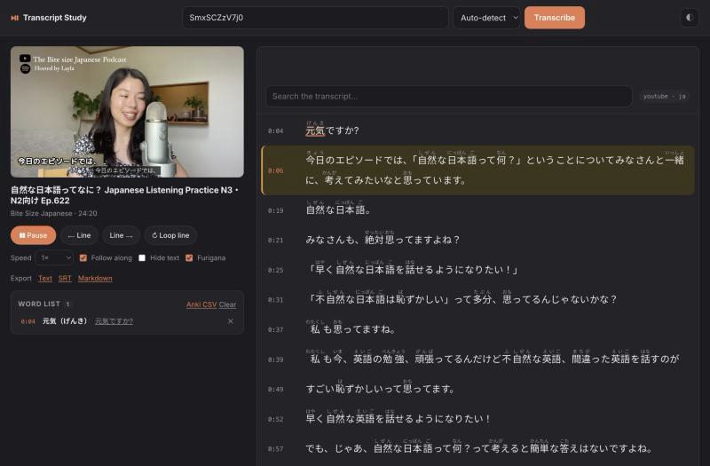

# Transcript Study

Paste a YouTube link, get a time-synced transcript you can actually study from.
Built for learning **English**, **German** and **Japanese**.

Runs on your own machine by default — no account, no API key, nothing uploaded.
The only thing that leaves your laptop is the request to YouTube.



## What it does

* **Pulls the real captions.** If the video has subtitles — the creator's own or
  YouTube's automatic ones — it uses those. That takes a second or two.
* **Falls back to offline speech-to-text.** No captions? The audio is transcribed
  locally with Whisper. Nothing is sent to a third party.
* **Keeps the text in sync.** The current line is highlighted as the video plays,
  the transcript scrolls along with it, and clicking a line jumps the video there.
* **Loops a single line** so you can replay a sentence until you catch every word.
* **Builds a word list.** Click any word to save it together with the sentence it
  came from and its timestamp. Export the list as a CSV that drops straight into
  Anki.
* **Furigana for Japanese.** The Japanese text is split into real words — not
  characters — and every kanji gets its reading above it. Toggle the readings off
  when you want to test yourself.
* **Hide-the-text mode** for pure listening practice: the transcript blurs out and
  only the line currently being spoken stays readable.
* **Saves the video** as MP4, or just the audio as MP3, for studying offline.

## Setup

You need [Homebrew](https://brew.sh) and Python 3.12 or newer.

```bash
brew install ffmpeg python@3.12
git clone https://github.com/vurado0/YouTube-Trandsciber.git
cd YouTube-Trandsciber
./setup.sh --with-whisper
```

`--with-whisper` installs the offline transcriber, roughly 300 MB of
dependencies plus a ~500 MB speech model that downloads the first time you
actually need it. Leave the flag off if you only ever study videos that already
have captions — everything else works the same, and you can add it later by
re-running the command.

## Running it

```bash
./run.sh
```

That starts a local server and opens <http://localhost:8000>. Paste a link,
pick the spoken language (or leave it on auto-detect), and press Transcribe.

To use a different port: `PORT=9000 ./run.sh`.

## Keyboard shortcuts

| Key | What it does |
| --- | --- |
| `Space` | Play / pause |
| `←` `→` | Previous / next line |
| `R` | Loop the current line |
| `F` | Follow along on/off |
| `H` | Hide the text (listening mode) |
| `/` | Jump to the search box |

## Deploying it

What you get depends on where you put it:

| | Local | Vercel | Docker host |
| --- | --- | --- | --- |
| Captions (en/de/ja) | yes | yes | yes |
| Furigana | yes | yes | yes |
| Word list, exports | yes | yes | yes |
| Offline Whisper | yes | **no** | optional |
| MP4 / MP3 download | yes | **no** | optional |

### Vercel

The app detects Vercel and switches to a single-request mode: the transcript is
fetched and returned inside the one HTTP request, because a serverless function
is frozen as soon as it responds and could never finish a job the browser polls
for. A 24-minute Japanese video, tokenised and with furigana, takes about 1.7
seconds and comes back as roughly 430 KB.

```bash
vercel          # preview deployment
vercel --prod   # production
```

`pyproject.toml` points Vercel at `main:app`, and `vercel.json` sets
`SERVERLESS=1` and a 60-second function limit. Nothing else to configure.

**What does not work there, and why.** Whisper needs an ffmpeg binary, a ~500 MB
model and minutes of CPU, against a 60-second function. Downloads need to stream
files far past the few-MB response cap — and the obvious workaround, handing the
browser YouTube's direct media URL, fails because those URLs are tied to the IP
that requested them. Both keep working locally from the same codebase.

**The real risk is not the code.** YouTube rate-limits and bot-blocks datacenter
IP ranges, and Vercel runs on them. Expect "Sign in to confirm you're not a bot"
to show up sooner or later. There is no fix for this from inside the app; it is
a property of where the request comes from. Running locally never has this
problem, because the request comes from your own connection.

### Docker, for everything at once

A persistent container keeps every feature, Whisper and downloads included.

```bash
docker build -t transcript-study .
docker run -p 8000:8000 -v transcript-data:/data transcript-study
```

On Fly.io, edit the `app` name in `fly.toml`, then:

```bash
fly auth login
fly launch --copy-config --no-deploy --ha=false --name your-unique-name
fly volumes create transcript_data --size 1 --region fra --yes
fly deploy
```

`--ha=false` matters: the default creates two machines, and two machines cannot
share one volume. Note that Fly has **no free tier** for new organisations as of
October 2026 — a trial of 2 hours of machine runtime or 7 days, then a card is
required. With `auto_stop_machines` the instance sleeps when idle, so light use
costs well under a dollar a month, but it is not free.

For Whisper on the server set `WITH_WHISPER = "1"` in `fly.toml`'s
`[build.args]` and run `fly scale memory 2048` — 1 GB is not enough for the
`small` model.

### Configuration

All of these are environment variables. Vercel and the container set
shared-instance defaults; running locally everything is on.

| Variable | Default (local / deployed) | What it does |
| --- | --- | --- |
| `SERVERLESS` | off / **on** (auto on Vercel) | One-request mode, no job polling |
| `ENABLE_WHISPER` | on / **off** | Offline transcription for caption-less videos |
| `ENABLE_DOWNLOADS` | on / **off** | The MP4 and MP3 buttons |
| `MAX_CONCURRENT_JOBS` | 2 | Jobs running at once; the rest queue |
| `RATE_LIMIT_PER_HOUR` | 40 | Requests per IP per hour, 0 to disable |
| `MAX_DURATION_SECONDS` | 0 / 2700 | Reject videos longer than this, 0 for no limit |
| `TRUST_PROXY` | off / **on** | Read the client IP from the proxy header |
| `WORK_DIR` | `./cache` | Where transcripts and prepared files live |
| `PORT` | 8000 | Port to listen on |

**Downloads are off by default once deployed, on purpose.** A publicly reachable
YouTube downloader will likely breach your host's terms of service, and it gets
the instance IP-blocked by YouTube much faster than caption fetching does. The
app has no login, so anyone with the URL can use whatever you switch on.

Japanese needs a MeCab dictionary. `unidic-lite` (248 MB, better readings) is
used when present; `ipadic` (51 MB) works as a smaller substitute and gives
better dictionary forms for verbs. The whole Vercel bundle with unidic-lite is
about 301 MB, inside the 500 MB function limit.

## How a video gets transcribed

1. The link is reduced to its 11-character video id and a clean watch URL is
   rebuilt from it. User input never reaches yt-dlp directly — otherwise it
   would happily fetch anything, including addresses on the host's own network.
2. `yt-dlp` is asked what caption tracks the video has.
3. If a track exists in the language you picked, it is downloaded as `json3` —
   YouTube's caption format, which carries per-word timings for automatic
   captions. Machine-translated tracks are skipped on purpose: a German track
   auto-translated from English reads badly and teaches you the wrong phrasing.
4. Caption fragments get merged into sentence-sized lines, because YouTube cuts
   them into two-second scraps that are hard to read.
5. If there is no usable track, the audio is downloaded, converted to 16 kHz mono
   with `ffmpeg`, and run through `faster-whisper`.
6. Japanese transcripts are tokenised with MeCab (`fugashi` + `unidic-lite`) to
   get word boundaries and readings, and the readings are aligned to the kanji so
   the okurigana stays out of the ruby text.
7. The result is cached so reopening a video is instant.

## Project layout

```
backend/
  app.py          FastAPI server, job queue, limits, caching
  captions.py     yt-dlp caption fetching, json3 parsing, sentence chunking
  whisper_asr.py  offline speech-to-text fallback
  downloads.py    MP4 and MP3 export
  japanese.py     tokenisation and furigana alignment
frontend/
  index.html      the whole UI
  app.js          player sync, word list, exports, downloads
  style.css       light and dark themes
main.py           entrypoint for serverless (Vercel) imports
pyproject.toml    Vercel entrypoint config
vercel.json       Vercel function settings
Dockerfile        container image for a persistent host
fly.toml          Fly.io deployment config
```

No build step and no frontend framework — edit a file, reload the page.

## Known limits

* **There is no login.** Anything you switch on is available to anyone who has
  the URL. Keep the instance private, or put it behind your host's access
  control.
* **Automatic captions are imperfect.** They lack punctuation on some channels
  and mishear names. For serious study, prefer videos with real subtitles.
* **Whisper is slow on a CPU.** Roughly real-time on Apple Silicon with the
  `small` model, so a 20-minute video takes about 20 minutes. It runs once per
  video and is then cached. Change `MODEL_SIZE` in `backend/whisper_asr.py` to
  `base` for speed or `medium` for accuracy.
* **Age-restricted and private videos won't load.** yt-dlp cannot reach them
  without signing in.
* Downloading media from YouTube may conflict with its Terms of Service. The
  caption path, which is what you will use most of the time, downloads no media.

## Licence

MIT.
